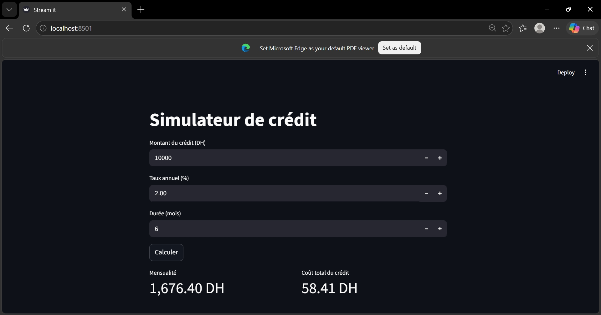
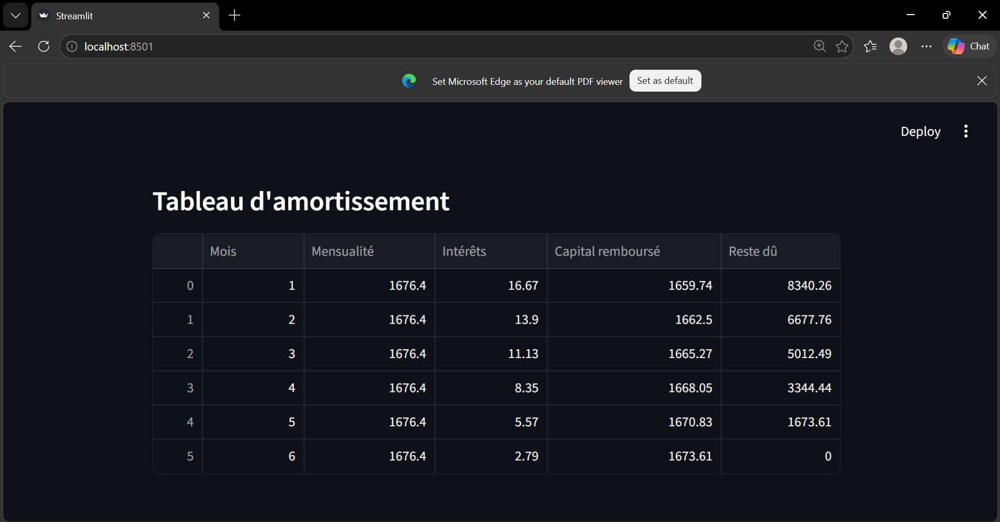
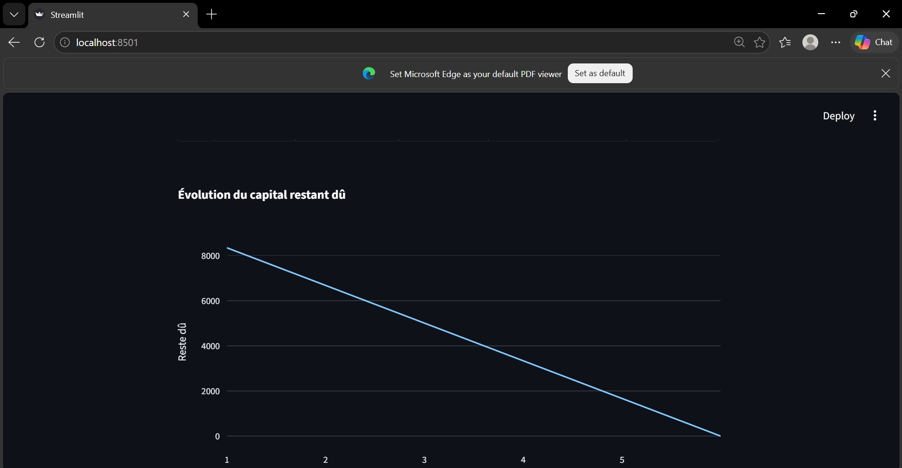

# Loan Amortization Calculator

🔗 Lien de l'application : [Easy Loan Amortization](https://easy-loan-amortization.streamlit.app)


Application web qui calcule la mensualité d'un crédit et affiche le tableau d'amortissement.

## Fonctionnalités
- Calcul de la mensualité et du coût total du crédit
- Tableau d'amortissement mois par mois (intérêts, capital remboursé, reste dû)
- Graphique de l'évolution du capital restant dû

## Technologies
Python, Streamlit, pandas, plotly

## Lancer le projet
```
pip install -r requirements.txt
streamlit run app.py
```

## Aperçu






